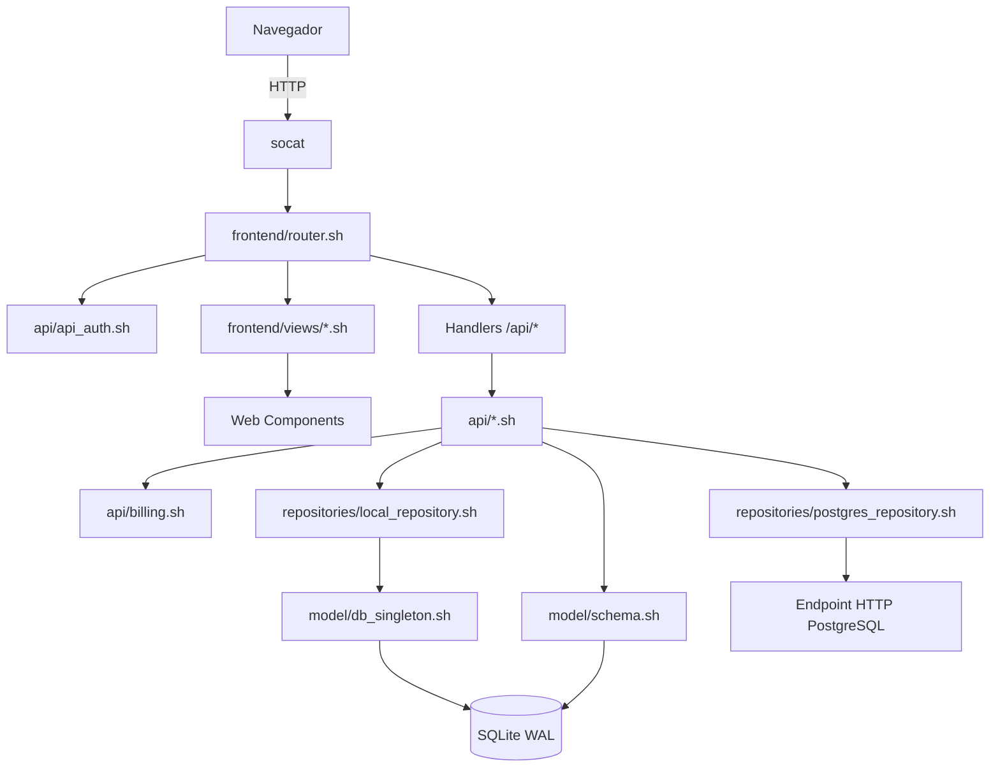

# 🥃 Áurea Destilería Artesanal — ERP Offline-First & Analítico

Sistema de Planificación de Recursos Empresariales (ERP) monolítico, ligero y portátil, desarrollado íntegramente en **Bash**, **SQLite**, **socat** y **Web Components nativos**.

Diseñado específicamente para operar con **cero dependencias pesadas** en hardware de bajos recursos, equipos reciclados o puntos de venta itinerantes (ferias, eventos y degustaciones) sin conexión a internet. Cuando se recupera la conectividad, permite sincronizar el estado completo de la operación con una instancia remota en **PostgreSQL**.

---

## 🎯 1. Filosofía y caso de uso

Los emprendimientos artesanales y los puntos de venta móviles suelen enfrentar dos problemas críticos: hardware limitado y conectividad inestable o inexistente. Este ERP resuelve ambos escenarios mediante una arquitectura **offline-first**:

- **Portabilidad y bajo consumo:** al prescindir de runtimes pesados (Python, JVM, Node.js en el servidor o frameworks SPA), el sistema se ejecuta directamente sobre el shell de Linux, con un consumo mínimo de memoria RAM y CPU.
- **Operación 100 % autónoma (local-first):** toda la lógica transaccional, el control de inventario, la producción por lotes y la analítica estadística residen en una base de datos **SQLite** local en modo WAL.
- **Sincronización idempotente:** al finalizar la jornada o recuperar la conexión, el administrador puede enviar un snapshot JSON completo hacia un endpoint HTTP respaldado por **PostgreSQL** mediante `curl`, garantizando consistencia sin riesgo de colas corruptas ni pérdida de datos.

---

## 🏗️ 2. Arquitectura y stack tecnológico

El proyecto sigue una separación estricta de responsabilidades inspirada en los patrones **MVC** y **Repository**.

- **Servidor HTTP y ruteo:** `socat` escucha en el puerto TCP configurado y delega cada petición a `frontend/router.sh`.
- **Persistencia (`model/`):** patrón Singleton (`db_singleton.sh`) que mantiene un coproceso SQLite activo por petición, con `foreign_keys = ON` y `journal_mode = WAL`. Esquema versionado (**v7**) con triggers de integridad y transacciones explícitas.
- **Lógica de negocio (`api/` y `repositories/`):** servicios modulares en Bash puro para catálogo, inventario, facturación, analítica y sincronización remota.
- **Interfaz de usuario (`frontend/`):** vistas HTML generadas en el servidor, acompañadas de **Web Components** nativos (`<erp-modal>`, `<product-manager>`, `<combo-builder>`, `<invoice-generator>`, entre otros) y CSS/JavaScript puro, sin dependencias de terceros.

### Diagrama de capas



---

## 🚀 3. Características principales

### 📦 Gestión integral del negocio (ERP)

- **Inventario y manufactura artesanal:** control de productos simples, combos dinámicos (cuya disponibilidad se calcula en tiempo real según el stock de sus componentes) e insumos de producción.
- **Recetas y lotes:** definición de fórmulas por unidad y pasos de preparación. El alta de un lote de producción (`ProductionBatches`) descuenta automáticamente los insumos requeridos y suma el producto terminado mediante triggers ACID.
- **Ventas directas y pedidos:** diferenciación entre ventas de mostrador (`direct`, con impacto inmediato en stock) y pedidos programados (`order`, con reserva y descuento al finalizar).
- **Cálculos monetarios:** importes autoritativos calculados en enteros (centavos) del lado del servidor.
- **Compras y reposición inteligente:** alertas automáticas de stock bajo y sugerencias de compra calculadas según la demanda histórica y los tiempos de entrega (*lead time*).
- **Facturación offline:** emisión de comprobantes (`V-*`, `P-*`, `C-*`) listos para imprimir o exportar a PDF directamente desde el navegador, sin conexión.
- **Auditoría inmutable y seguridad:** bitácora completa (`InventoryJournal`) impulsada por triggers de base de datos, autenticación con hashes SHA-256 y sal, sesiones mediante cookies `HttpOnly`, roles (`admin` / `cajero`) y autorización por PIN para anulaciones.

### 📊 Inteligencia de negocio y motor estadístico (`api/analytics.sh`)

El dashboard gerencial procesa los datos históricos directamente en el servidor para ofrecer métricas accionables sin librerías externas:

- **Estadística descriptiva y outliers:** cálculo de media, desviación estándar muestral, coeficiente de variación (\(CV\%\)), cuartiles (\(Q_1\), \(Q_3\)) y rango intercuartílico (\(IQR\)) para detectar picos anómalos de venta mediante el criterio \(Q_3 + 1.5 \cdot IQR\).
- **Punto de pedido y stock de seguridad:** estimación dinámica de reposición considerando demanda diaria, variabilidad y nivel de servicio del 95 % (\(Z = 1.65\)), con *lead times* diferenciados (4 días para productos y 7 días para insumos).
- **Probabilidad binomial en horas pico:** cálculo de \(P(X \ge k)\) sobre la franja horaria de mayor tráfico histórico para prever la saturación de inventario.
- **Intervalos de confianza de costos:** estimación al 95 % del costo unitario real de producción por lote, mediante la expresión:

  \[
  \bar{x} \pm 1.96 \frac{s}{\sqrt{n}}
  \]

- **Contraste de hipótesis (validación de sabores):** prueba Z unilateral (\(H_0: p = 0.40\) vs. \(H_1: p > 0.40\)) sobre degustaciones y ventas de productos estacionales para decidir su pase a producción masiva.
- **Análisis de canasta, covarianza y regresión lineal:** matriz de correlación de Pearson, covarianza muestral y ajuste por mínimos cuadrados (\(y = \beta_0 + \beta_1 x\)) para sugerir combos inteligentes (productos complementarios) e identificar productos sustitutos.

---

## 🛠️ 4. Requisitos e instalación

### Dependencias del sistema

- Bash 4.0 o superior.
- SQLite 3 (`sqlite3`).
- `socat` (para el servidor HTTP).
- `curl` (opcional; requerido únicamente para la sincronización con PostgreSQL).

> **Nota:** el proyecto incluye un adaptador de respaldo, `tools/sqlite3_shim.js`, para el caso en que el binario `sqlite3` no esté instalado.

En sistemas basados en Debian/Ubuntu:

```bash
sudo apt update && sudo apt install -y sqlite3 socat curl
```

### Puesta en marcha

1. Clonar el repositorio:

   ```bash
   git clone https://github.com/Br1-O/ERP_bash.git
   cd ERP_bash
   ```

2. Inicializar la base de datos (crea el esquema v7 y carga datos de demostración):

   ```bash
   ./erp.sh init
   ```

3. Iniciar el servidor web:

   ```bash
   ./erp.sh server 8080
   ```

4. Abrir `http://localhost:8080` en el navegador.

### Credenciales de demostración

| Rol | Usuario | Contraseña |
|---|---|---|
| Administrador | `admin` | `admin123` |
| Cajero | `cajero` | `cajero123` |

---

## 🌐 5. Mapa de rutas principales

### Vistas web

| Ruta | Descripción |
|---|---|
| `/` | Redirige automáticamente a `/dashboard`. |
| `/login` | Autenticación de usuarios y creación de sesión. |
| `/dashboard` | Panel gerencial con KPIs, alertas de stock, gráficos y resumen estadístico (`#resumen`, `#stock`, `#catalogo`, `#agenda`). |
| `/inteligencia` | Matriz de correlación de Pearson completa, combos sugeridos y análisis de sustitutos. |
| `/inventario` | Gestión de productos, insumos, recetas, armado de combos y registro de lotes de producción. |
| `/ventas` | Registro de ventas directas, gestión de estados de pedidos y emisión de comprobantes. |
| `/compras` | Órdenes de compra a proveedores y flujo de reposición sugerida. |
| `/auditoria` | Historial completo de `InventoryJournal`, con búsqueda y trazabilidad de entidades. |
| `/contactos` | Agenda de clientes (mayoristas y minoristas) y proveedores. |
| `/configuracion` | Parámetros de la empresa para facturación (requiere rol `admin`). |

### Endpoints de la API REST (JSON)

| Área | Endpoints |
|---|---|
| Estado y analítica | `/api/health`, `/api/dashboard`, `/api/alerts`, `/api/analytics/basket` |
| Catálogo e inventario | `/api/products`, `/api/inputs`, `/api/production`, `/api/recommendations` |
| Operaciones | `/api/sales`, `/api/orders`, `/api/purchases`, `/api/invoices/{sales\|orders\|purchases}/:id` |
| Sistema | `/api/audit`, `/api/contacts`, `/api/business-info`, `/api/sync/{status\|config\|push}` |

---

## 🔄 6. Sincronización con PostgreSQL

La sincronización se realiza mediante un **snapshot JSON completo**, generado localmente y enviado mediante `curl` de forma idempotente (`ON CONFLICT DO UPDATE`) hacia un endpoint receptor en PostgreSQL.

```text
POST /api/sync/push
    -> local_repo_snapshot_json()
    -> pg_repo_push()
    -> SyncLog
```

- **Offline-first:** si la red falla, SQLite continúa operando localmente y sin interrupciones. Los datos locales no se pierden ni se bloquea la operación.
- **Seguridad:** los tokens de autenticación se almacenan de forma segura en `AppContext` y no se exponen en las respuestas de la API pública.

---

## 📚 7. Documentación técnica de apoyo

Para consultas detalladas sobre la implementación interna, podés revisar los siguientes documentos dentro del directorio [`docs/`](docs/):

| Documento | Contenido |
|---|---|
| [ARQUITECTURA.md](docs/ARQUITECTURA.md) | Estructura de capas y flujo de peticiones. |
| [RUTAS.md](docs/RUTAS.md) | Contratos completos de API y payloads. |
| [BASE_DE_DATOS.md](docs/BASE_DE_DATOS.md) | Diccionario de datos, triggers e índices. |
| [DIAGRAMAS.md](docs/DIAGRAMAS.md) | Diagramas Mermaid de clases, módulos, base de datos, estados y secuencias. |
| [SINCRONIZACION.md](docs/SINCRONIZACION.md) | Contrato del snapshot y sincronización con PostgreSQL. |
| [ESTADISTICA.md](docs/ESTADISTICA.md) | Fundamentos matemáticos del motor analítico. |
