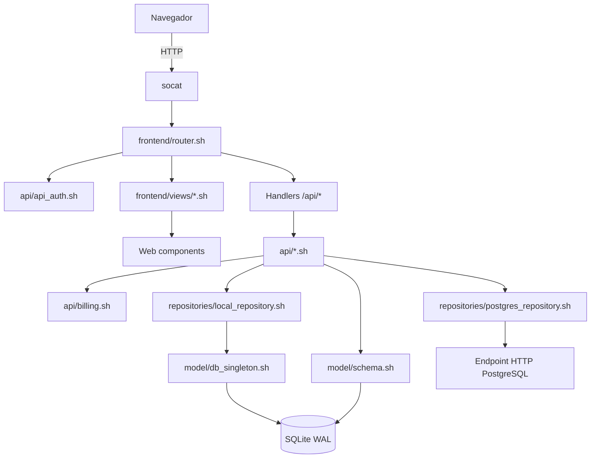

# Arquitectura

Actualizado para el esquema **v8**, ferias/eventos con stock segmentado, ventas
por canal, outbox transaccional y sincronización híbrida (eventos + pull +
snapshot) con PostgreSQL.

## 1. Visión general

El ERP es una aplicación monolítica offline-first:

- **Bash** implementa el enrutador HTTP, los servicios de negocio, las vistas y
  la capa de acceso a datos.
- **SQLite** es la fuente de verdad local. La base se abre mediante un
  coproceso singleton por proceso del servidor.
- **socat** acepta conexiones TCP y ejecuta `frontend/router.sh` una vez por
  petición.
- **HTML/CSS/JavaScript nativo** construye la interfaz. No hay Node.js en el
  frontend, bundlers, frameworks SPA ni dependencias de terceros.
- **curl** transporta los eventos pendientes, el pull e-commerce y el snapshot
  de respaldo hacia un endpoint HTTP que escribe en PostgreSQL.

Restricciones del proyecto:

- Solo Bash, JavaScript, CSS, HTML y SQLite.
- No se usa Python ni automatización de navegador.
- No se usa el protocolo nativo de PostgreSQL desde el ERP.

## 2. Diagrama de capas



## 3. Estructura del repositorio

| Ruta | Responsabilidad |
|---|---|
| `config.sh` | Carga centralizada de todos los módulos y variables de entorno. |
| `erp.sh` | Punto de entrada: servidor, CLI, inicialización y ayuda. |
| `server.sh` | Valida dependencias e inicia `socat` sobre el puerto indicado. |
| `router.sh` | Enlace simbólico o envoltorio de `frontend/router.sh`. |
| `frontend/router.sh` | Lee la petición HTTP, autentica, enruta páginas, assets y API. |
| `frontend/views/` | Vistas Bash que devuelven HTML completo por página. |
| `frontend/components/` | Web components: lógica de negocio de la interfaz. |
| `frontend/assets/` | CSS global, dashboard, inteligencia de canasta, billing, utilidades y componentes base. |
| `frontend/cli/` | Interfaz de terminal para operaciones de administración. |
| `api/` | Servicios de autenticación, catálogo, inventario, compras, ventas, pedidos, facturas, sync y analítica. |
| `repositories/` | Acceso local (snapshot/bitácora) y remoto (envío HTTP a PostgreSQL). |
| `model/` | Esquema, singleton SQLite, transacciones y contexto de auditoría. |
| `shared/utils/` | Parseo HTTP, JSON, validaciones y helpers. |
| `tools/sqlite3_shim.js` | Adaptador `node:sqlite` cuando no existe el binario `sqlite3`. |
| `tests/mock_sync.sh` | Endpoint HTTP de prueba para la sincronización. |
| `docs/` | Documentación funcional, técnica y diagramas. |

## 4. Ciclo de una petición HTTP

1. `socat` acepta la conexión y ejecuta `frontend/router.sh`.
2. El router carga `config.sh`, que importa todos los módulos.
3. `db_singleton_init` abre SQLite si aún no está abierto y aplica el esquema.
4. `http_read_request` parsea método, ruta, query string, cookies, headers y
   cuerpo.
5. Se resuelven assets estáticos, páginas HTML o rutas `/api/*`.
6. Las APIs validan la sesión y el rol cuando corresponde.
7. El servicio de negocio usa `db_query`, `db_scalar` o `db_exec`; las
   operaciones compuestas usan transacciones.
8. La respuesta se envía como HTML o JSON.
9. Al terminar, el router cierra la conexión SQLite del proceso.

La sesión se guarda en la tabla `Sessions` y viaja en la cookie
`erp_session` (`HttpOnly`, `SameSite=Lax`, 8 horas).

## 5. Backend

### 5.1 Capa de modelo

- `model/db_singleton.sh`: mantiene un único proceso SQLite por petición.
  Expone `db_query`, `db_scalar`, `db_exec`, `db_last_insert_id`, `db_quote`,
  `db_set_context_user`.
- `model/schema.sh`: DDL, migraciones de columnas legacy, índices, triggers,
  datos demo y versión `ERP_SCHEMA_VERSION=8`.
- `model/transactions.sh`: `tx_begin`, `tx_commit`, `tx_rollback`.

Los PRAGMA activos son:

```sql
PRAGMA busy_timeout = 5000;
PRAGMA journal_mode = WAL;
PRAGMA synchronous = NORMAL;
PRAGMA foreign_keys = ON;
```

### 5.2 Servicios de negocio

| Módulo | Funciones principales |
|---|---|
| `api/api_auth.sh` | Usuarios, hash con sal, login, sesiones, cookies, permisos, PIN de autorización y detalle público de usuario. |
| `api/api_catalog.sh` | Listados de productos, insumos, clientes y proveedores; altas, edición y baja lógica de contactos; ficha de cliente. |
| `api/api_inventory.sh` | CRUD de productos/insumos, recetas, combos, stock disponible, reposición de insumos. |
| `api/api_purchases.sh` | Pedidos de compra, detalle, edición, estados, baja y recomendaciones de reposición. |
| `api/api_sales.sh` | Ventas directas, lotes de producción, anulación con motivo/PIN y consulta paginada de auditoría. |
| `api/api_orders.sh` | Listado unificado de ventas/pedidos; etapas, edición, baja lógica y anulación de pedidos. |
| `api/api_business.sh` | Datos de la empresa. |
| `api/api_invoices.sh` | Facturas JSON de compras, pedidos y ventas directas finalizadas. |
| `api/api_events.sh` | Eventos/ferias, asignación de stock, cierre con pérdidas, estadísticas y series. |
| `api/api_sync.sh` | Configuración, push de eventos, pull e-commerce y snapshot de respaldo. |
| `api/billing.sh` | Estrategias de descuento y conversión a centavos. |
| `api/analytics.sh` | KPIs, series, alertas, reposición, intervalos, regresión y canasta. |

### 5.3 Reglas de negocio centrales

- Una venta directa se registra con `order_type='direct'`,
  `order_stage='delivered'` y `status='finished'`; los triggers descuentan
  stock al insertar los ítems.
- Un pedido se crea con `order_type='order'` y una etapa inicial
  `draft|pending|preparing|confirmed|paid|delivered`. Desde `confirmed` el
  stock queda aplicado; `paid` y `delivered` cuentan como ingreso.
- `stock_applied` evita descontar o restaurar dos veces.
- Toda anulación exige motivo de 3 a 300 caracteres y PIN válido de un
  administrador o supervisor activo. Se conserva el registro original, se
  marca `order_stage='cancel'` y se audita en `InventoryJournal`.
- `delivered` y `cancel` son finales; `paid` solo puede avanzar a
  `delivered` o anularse. Las etapas finales no se reabren.
- Un combo no tiene stock propio: su disponibilidad es el mínimo entero entre
  `stock_componente / cantidad_requerida`.
- La producción siempre crea un `ProductionBatches` y consume los insumos
  indicados en `ProductionInputs`; ambos efectos son transaccionales.
- Un pedido de compra nace en `pending`; al pasar a `finished` actualiza el
  stock y el costo del insumo por cada ítem.
- Los importes de venta se recalculan en el servidor con enteros en centavos.
- Crear un evento transfiere stock de `SEDE` a `EventStock`; las ventas de
  feria consumen solo `EventStock` y nunca `Products.stock`.
- Al cerrar un evento se calculan pérdidas/sobrantes con costo histórico y se
  devuelve el stock sobrante a `SEDE`; el evento queda inmutable.
- Cada mutación y su fila de `InventoryJournal` se confirman en la misma
  transacción. El journal es el outbox de sincronización (`synced=0`).

## 6. Frontend

Las páginas se renderizan en el servidor con un layout común. Los componentes
se cargan bajo demanda desde `/components/<componente>/<archivo>`.

| Componente | Responsabilidad |
|---|---|
| `erp-modal` | Modal accesible reutilizable. |
| `erp-pagination` | Paginación de tablas. |
| `erp-recipe-editor` | Edición de receta y cantidades por unidad. |
| `combo-builder` | Alta rápida de combos con productos sugeridos, cantidades y totales estimados. |
| `product-detail` | Detalle de producto del catálogo del dashboard, con receta, componentes y acciones. |
| `product-manager` | Catálogo, detalle, alta/edición, combos, stock y producción. |
| `input-manager` | Insumos, reposición y detalle. |
| `purchase-manager` | Recomendaciones, alta/edición de pedidos, estados, historial e invoice. |
| `order-manager` | Ventas y pedidos, alta de venta directa, etapas, edición, anulación con motivo/PIN e invoice. |
| `user-manager` | Lista, alta y edición de vendedores/supervisores, permisos y PIN. |
| `audit-manager` | Historial de auditoría con búsqueda, paginación y detalle de entidades. |
| `contact-manager` | Clientes y proveedores con alta, edición y baja lógica. |
| `business-settings` | Datos de la empresa. |
| `invoice-generator` | Factura imprimible y PDF en el navegador. |

`frontend/assets/app.js` maneja el dashboard: KPIs, gráficos, alertas,
reposición, catálogo paginado, agenda, sincronización y anulación rápida de
ventas recientes.
`frontend/assets/insights.js` maneja `/inteligencia`: matriz de Pearson completa,
combos inteligentes y sustitutos con búsqueda, orden y paginación. El dashboard
mantiene las tarjetas compactas y enlaza a esta página desde el menú lateral.
`audit-manager` maneja `/auditoria`: consulta `/api/audit`, pagina y abre el
detalle del movimiento o de sus entidades referenciadas.

### 6.1 Enlaces profundos de reposición

- Insumos: `/compras?input=<id>`
  - `purchase-manager` busca la recomendación, consulta
    `/api/suppliers/<supplier_id>` y muestra todos los insumos activos del
    proveedor.
  - El insumo solicitado queda preseleccionado; los demás se pueden agregar al
    pedido.
- Productos: `/inventario?product=<id>&produce=1`
  - `product-manager` abre el modal de producción con la cantidad sugerida y
    los insumos de la receta precargados.
  - Si el producto es un combo, se abre el detalle porque el combo no se
    produce directamente.
- Las alertas y filas de reposición del dashboard son enlaces o filas
  clicables con estos destinos.

## 7. Flujos principales

### 7.1 Venta directa

```text
/ventas -> "+ Nueva venta" o dashboard
  -> POST /api/sales
  -> valida cliente activo, productos, stock y descuento
  -> INSERT Sales (direct, delivered, finished)
  -> INSERT SaleItems
  -> triggers descuentan stock (o componentes de combos)
  -> respuesta con sale_id, subtotal, discount y total
  -> GET /api/invoices/sales/:id para el comprobante V-*
```

### 7.2 Pedido de cliente

```text
POST /api/orders            -> Sales (order, etapa inicial), sin stock
PUT  /api/orders/:id/status -> confirmed aplica stock
PUT  /api/orders/:id/status -> paid/delivered conservan el stock aplicado
PUT  /api/orders/:id        -> solo en draft/pending/preparing
DELETE /api/orders/:id      -> baja lógica con reason + PIN
POST /api/orders/:id/cancel -> anulación con reason + PIN
```

### 7.2.1 Anulación

```text
/ventas o dashboard -> "Anular venta"
  -> POST /api/sales/:id/cancel (o /api/orders/:id/cancel)
  -> valida motivo y PIN de admin/supervisor activo
  -> UPDATE Sales status='cancel', order_stage='cancel', metadata
  -> trigger restaura stock si estaba aplicado
  -> INSERT InventoryJournal (SALE_CANCELLED u ORDER_CANCELLED)
  -> el usuario crea una nueva venta corregida
```

### 7.3 Compra y reposición de insumos

```text
/compras -> "+ Nuevo pedido" o reposición sugerida
  -> purchase-manager consulta proveedores e insumos
  -> usuario ajusta cantidades y costos
  -> POST /api/purchases (pending, sin stock)
  -> PUT /api/purchases/:id/status (finished)
  -> triggers suman stock y actualizan costo
  -> PUT /api/purchases/:id/status (processing) revierte stock
```

### 7.4 Producción

```text
Dashboard /inventario?product=ID&produce=1
  -> product-manager abre modal de producción
  -> POST /api/production con items de insumos
  -> INSERT ProductionBatches (trigger suma stock)
  -> INSERT ProductionInputs (trigger descuenta insumos)
```

### 7.4.1 Eventos y ferias

```text
/eventos -> "+ Nuevo evento"
  -> POST /api/events con productos/cantidades
  -> INSERT Events + EventStock
  -> trigger descuenta Products.stock (SEDE -> FERIA)
/ventas -> venta/pedido con event_id
  -> trigger consume EventStock.sold_qty
/eventos -> "Cerrar"
  -> POST /api/events/:id/close con pérdidas
  -> calcula sobrantes, devuelve stock y congela finanzas
```

### 7.5 Facturación

```text
GET /api/invoices/purchases/:id -> C-000001 (solo finished)
GET /api/invoices/orders/:id    -> P-000001 (solo paid/delivered)
GET /api/invoices/sales/:id     -> V-000001 (solo delivered)
```

El servidor entrega JSON con datos de empresa y documento; el navegador genera
el PDF y la impresión sin conexión.

### 7.6 Sincronización

```text
POST /api/sync/push
  -> Fase 1: local_repo_pending_events_json()
             pg_repo_push_events() -> marcar synced=1
  -> Fase 2: pg_repo_pull_events(last_remote_journal_id)
             local_repo_apply_remote_events() -> Sales/stock SEDE
  -> Fase 3: local_repo_snapshot_json()
             pg_repo_push() -> SyncLog (ok/error, endpoint, bytes)
```

Cada fase falla de forma independiente. El pull usa `event_uuid` para no
duplicar ventas ni movimientos. Ver
[SINCRONIZACION.md](SINCRONIZACION.md) para el contrato completo.

## 8. Seguridad y permisos

- Contraseñas con sal y SHA-256 almacenadas en `Users`.
- Sesiones con token aleatorio, expiración de 8 horas y cookie `HttpOnly`.
- Roles: `admin`, `supervisor` y `vendedor`.
- Los permisos de supervisor (`can_view_metrics`, `can_manage_stock`) limitan
  páginas y APIs; el vendedor siempre opera sin métricas ni stock.
- Solo `admin` administra usuarios, empresa y sincronización. No puede crear
  administradores ni degradar su propia cuenta desde la API.
- Los PIN de administrador/supervisor se almacenan con sal y SHA-256 y se usan
  para autorizar anulaciones. Nunca se devuelven en las respuestas.
- Las APIs privadas exigen sesión válida; las páginas redirigen a `/login` o a
  la página inicial permitida.
- El token de sincronización no se devuelve desde `/api/sync/status`.
- El servidor no registra secretos en la bitácora.

## 9. Pruebas y verificación

Sin automatización de navegador:

```bash
bash -n config.sh erp.sh server.sh frontend/router.sh
bash -n frontend/views/dashboard.sh frontend/views/insights.sh frontend/views/audit.sh frontend/views/users.sh
node --check frontend/assets/app.js
node --check frontend/assets/insights.js
node --check frontend/components/order-manager/order-manager.js
node --check frontend/components/user-manager/user-manager.js
node --check frontend/components/audit-manager/audit-manager.js
node --check frontend/components/purchase-manager/purchase-manager.js
node --check frontend/components/product-manager/product-manager.js
node --check frontend/components/combo-builder/combo-builder.js
node --check frontend/components/product-detail/product-detail.js
./erp.sh init
```

Pruebas HTTP con base temporal:

```bash
ERP_DB_PATH=/tmp/erp_test.db ./erp.sh init
ERP_DB_PATH=/tmp/erp_test.db ./erp.sh server 8099
curl -s http://127.0.0.1:8099/api/health
```

Para inspeccionar la base sin el binario `sqlite3`, usar el shim:

```bash
node --no-warnings tools/sqlite3_shim.js shared/data/erp_licores.db \
  "SELECT id, name FROM Products ORDER BY id;"
```

## 10. Puntos de extensión

- Nuevas rutas API: agregar handler en `frontend/router.sh` y servicio en
  `api/`.
- Nuevas tablas: actualizar `model/schema.sh`, `local_repository.sh`,
  `docs/BASE_DE_DATOS.md`, `docs/SYNC_POSTGRES.sql` y la versión de esquema.
- Nuevos componentes: crear carpeta en `frontend/components/`, registrar
  assets en la vista y cargar el HTML desde el componente.
- Nuevas métricas: agregar funciones puras en `api/analytics.sh` y consumirlas
  desde `frontend/assets/app.js` (dashboard) o `frontend/assets/insights.js`
  (página completa).
