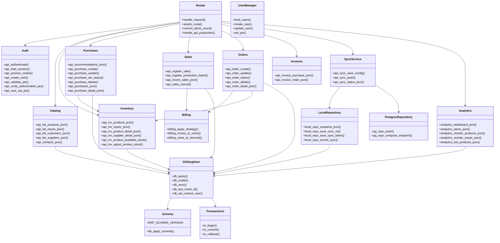
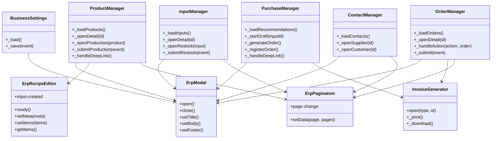
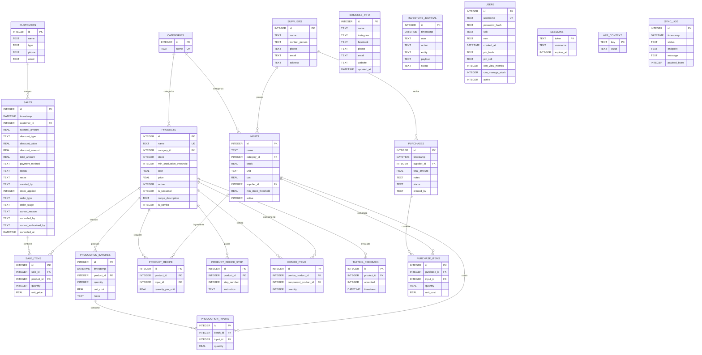
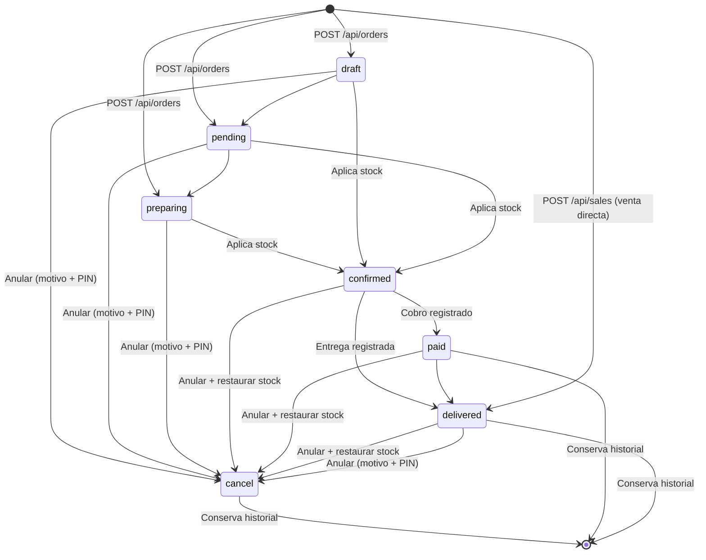
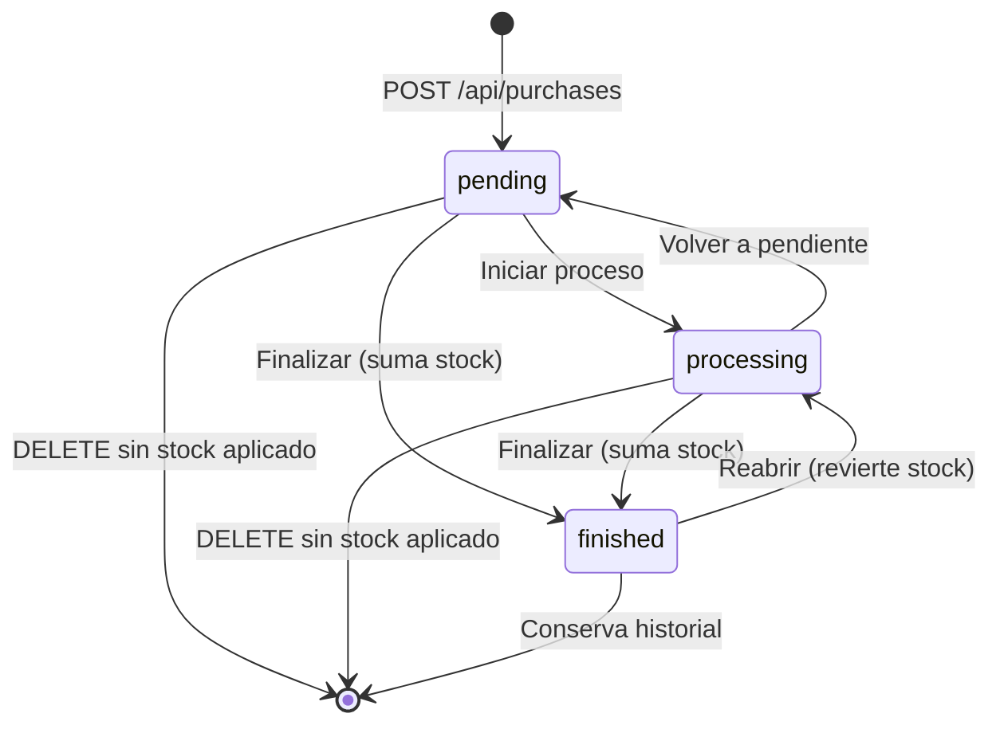
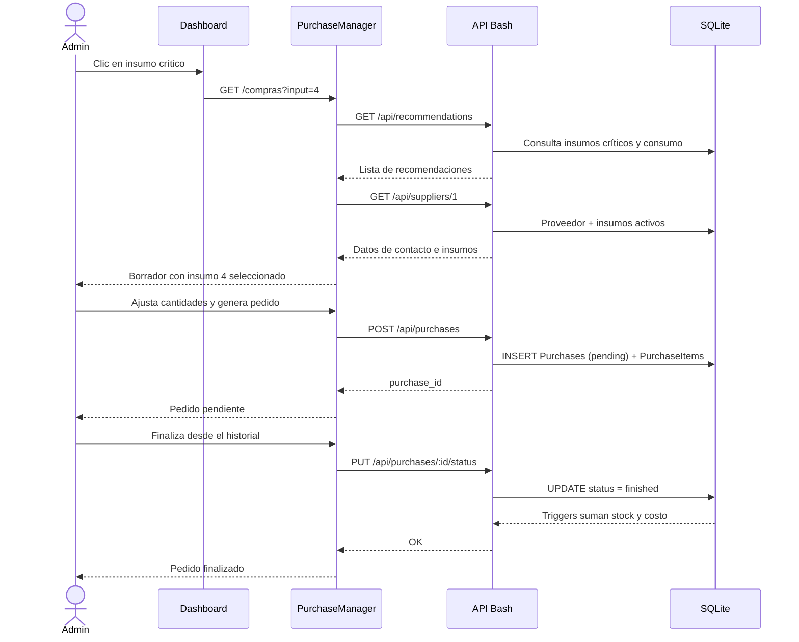
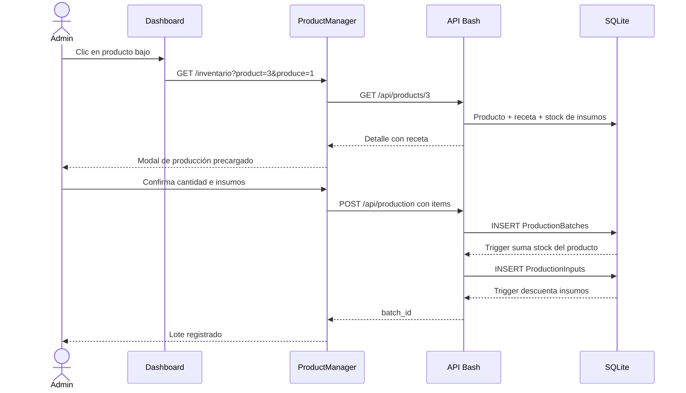
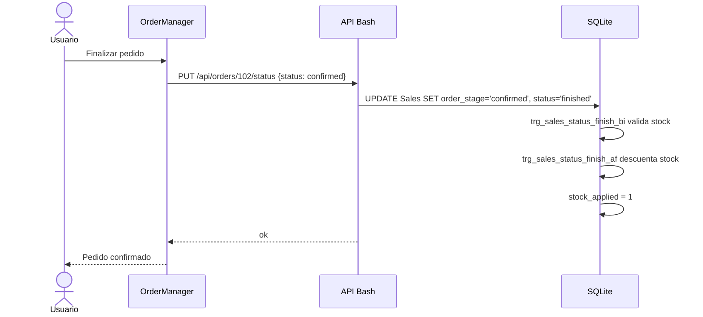
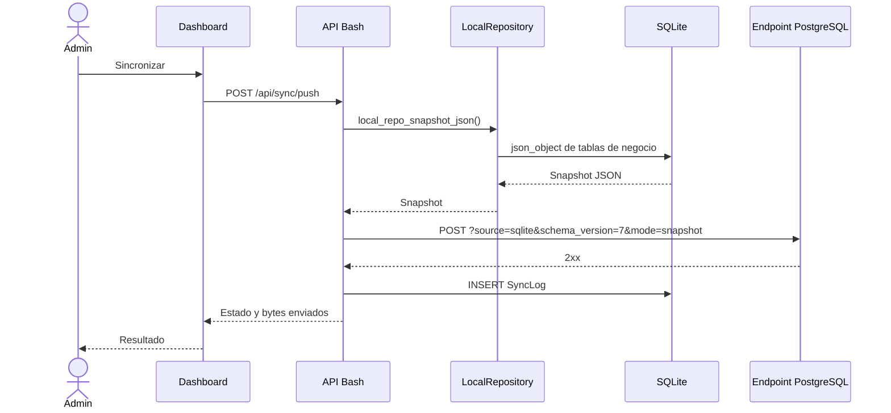

# Diagramas

Los diagramas usan Mermaid y se renderizan en visores compatibles (GitHub,
GitLab, VS Code, Obsidian). El backend está implementado con módulos Bash, no
con clases; el diagrama de clases modela responsabilidades y dependencias.

## 1. Diagrama de clases y módulos



### 1.1 Componentes web



## 2. Diagrama ER de la base de datos



## 3. Estados de una venta o pedido



Notas:

- `stock_applied=1` desde `confirmed` hasta antes de la anulación.
- `paid` y `delivered` cuentan como ingreso; `confirmed` no.
- Reabrir desde etapas finales no está permitido.
- Anular restaura stock una única vez y exige motivo + PIN de
  administrador/supervisor.
- La baja temprana (`DELETE`) es lógica y exige motivo + PIN.
- Las ventas directas nacen en `delivered` y no se reabren.

### 3.1 Estados de un pedido de compra



Notas:

- El stock se aplica una sola vez al entrar en `finished`.
- Reabrir resta el stock recibido y falla si ya fue consumido.
- Con `stock_applied=1` no se editan ítems ni se elimina el pedido.

## 4. Secuencia: reposición de insumo desde una alerta



## 5. Secuencia: producción desde una alerta de producto



## 6. Secuencia: finalizar un pedido



## 6.1 Secuencia: anular una venta

```mermaid
sequenceDiagram
    actor Usuario
    participant UI as OrderManager/Dashboard
    participant API as API Bash
    participant DB as SQLite

    Usuario->>UI: Anular venta + motivo + PIN
    UI->>API: POST /api/sales/102/cancel
    API->>DB: valida PIN de admin/supervisor activo
    API->>DB: UPDATE Sales status='cancel', order_stage='cancel'
    DB->>DB: trg_sales_status_unapply_af restaura stock
    API->>DB: INSERT InventoryJournal SALE_CANCELLED
    API-->>UI: ok
    UI-->>Usuario: Venta anulada; crear venta corregida
```

## 7. Secuencia: sincronización con PostgreSQL


